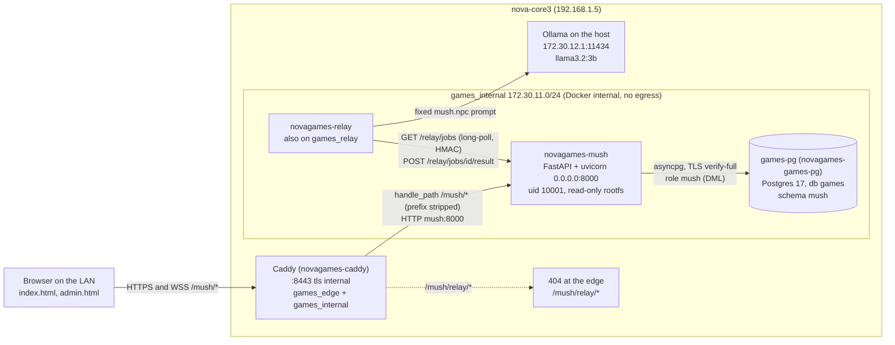
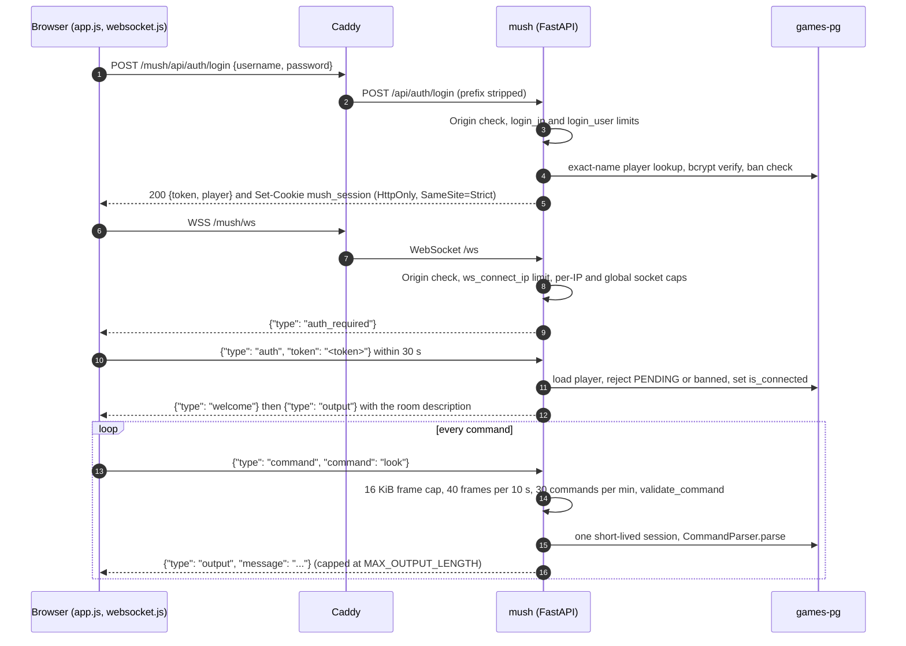
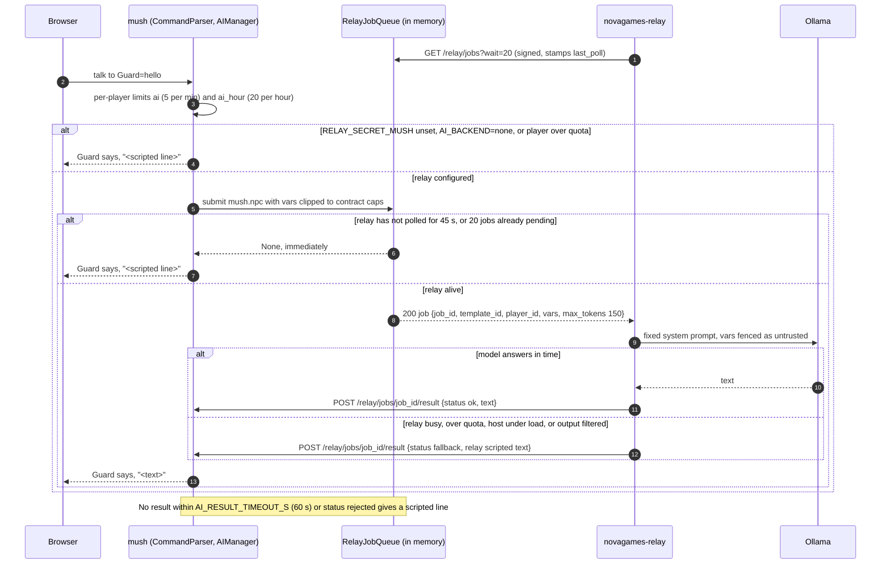

# Web-Pennmush

A web-based MUSH server inspired by [PennMUSH](https://github.com/pennmush/pennmush). Python (FastAPI, SQLAlchemy async, uvicorn) on the server, plain JavaScript in the browser, one WebSocket per player.


[](LICENSE)


It runs as the `mush` service of the Nova Games platform on nova-core3 and is served at **https://192.168.1.5:8443/mush/** (LAN only). NPC dialogue comes from a local LLM, but the server never calls a model itself. It queues fixed-template jobs that the Nova Games relay pulls, and when the relay is down it answers at once with a scripted line.

Author: Jordan Koch ([kochj23](https://github.com/kochj23)). Personal project, MIT licensed.

---

## Contents

- [Architecture](#architecture)
- [Features](#features)
- [Commands](#commands)
- [Softcode](#softcode)
- [AI NPCs and the relay](#ai-npcs-and-the-relay)
- [Authentication and sessions](#authentication-and-sessions)
- [Rate limits and connection caps](#rate-limits-and-connection-caps)
- [REST API](#rest-api)
- [WebSocket protocol](#websocket-protocol)
- [Security model](#security-model)
- [Deployment (nova-core3)](#deployment-nova-core3)
- [Postgres (Games DB)](#postgres-games-db)
- [Play history](#play-history)
- [TLS](#tls)
- [Configuration](#configuration)
- [Local development](#local-development)
- [Tests](#tests)
- [Known limitations](#known-limitations)
- [Project layout](#project-layout)
- [Documentation](#documentation)
- [License](#license)

---

## Architecture



- Caddy terminates TLS with its internal CA and strips the `/mush` prefix, so the app sees `/`, `/ws`, `/api/...`, `/healthz`. Every client URL in the frontend is relative for that reason.
- The mush container is attached only to `games_internal`. It has no host ports, no internet, no LAN access. Its only peers are Caddy, games-pg and the relay.
- The relay is the only component that can reach Ollama (via `games_relay`). Traffic is outbound from the relay to the game: the game never connects to the relay.

### A player command over the WebSocket



### AI NPC line through the relay, with fallback



---

## Features

Everything below is taken from the current code in `backend/` and `frontend/`. Gaps are listed under [Known limitations](#known-limitations).

**World model.** Rooms, things, exits and players are rows in one `objects` table (types ROOM, THING, EXIT, PLAYER, GARBAGE), with comma-separated flags, aliases, owner, location and home. Attributes, locks, mail, pages, channels, channel memberships, help topics, NPCs, quests, quest steps, quest progress, player currency, transactions and ban records have their own tables (`backend/models.py`). Destroyed objects become GARBAGE (soft delete). The first start seeds Room Zero (#0), the God player One (#1), Central Plaza (#2, the starting room), a portal and void exit pair, a "magic crystal" with sample attributes, the Public (`pub`), Newbie (`new`) and Builder (`build`) channels, and seven help topics.

**Frontend** (`frontend/index.html`, `js/app.js`, `js/websocket.js`, `js/ui.js`). Login and registration modal (with an invite-code field), output window, command input with Up/Down history, room panel (name, exits, contents), players-online list refreshed every 30 s, activity log, connection status, and reconnect (5 attempts, 3 s apart). Login goes through REST. The token it returns authenticates the WebSocket, so the password never travels over the socket. All user-controlled text is rendered with `textContent`. There are no inline scripts, styles or handlers, so the page works under the strict CSP.

**Room map** (`frontend/js/roommap.js`, `GET /api/rooms/map`). An SVG graph of rooms and exits drawn with a small built-in force layout (no D3 or other library). The current room is highlighted. Players get a radius of up to 3 around their own location. Admins can choose any centre and a radius up to 10. The breadth-first search stops at 200 nodes, and DARK rooms are hidden from non-admins.

**Admin panel** (`/admin`, `frontend/admin.html`, `js/admin.js`). Served only to a logged-in, non-pending GOD, WIZARD or ROYAL session. Anyone else is redirected to `./`. It shows server stats (players, connected, rooms, objects), the AI relay status, and the player list with pending accounts and an Approve button. It refreshes every 30 s and uses the HttpOnly session cookie.

**Channels** (`backend/engine/channels.py`). List, join, leave, who, create (with optional alias), and speaking by alias (`pub Hello`) for channel members.

**Mail** (`backend/engine/mail.py`). Subject and body, inbox with read/unread state, read and delete by number.

**Pages** (`backend/engine/pages.py`). Direct messages to connected players, with a stored history of the last 10. Offline recipients get a pointer to `@mail`.

**Quests** (`backend/engine/quests.py`). Admin-created quests with numbered steps and a credit reward. Players can list active quests, start one, and view progress and their quest log.

**Economy** (`backend/engine/economy.py`). Per-player credit balance (created at 0 on first use), player-to-player `give`, a transaction log, admin grants, and economy statistics.

**Moderation** (`backend/engine/moderation.py`). Ban with reason and optional duration in days. Bans are enforced at REST login, WebSocket password login and WebSocket token login. Also unban, ban list, kick, and muzzle/unmuzzle (sets the MUZZLED flag). A non-GOD admin cannot ban GOD.

**Locks** (`backend/engine/locks.py`). Lock keys with AND `&`, OR `|`, NOT `!` and parentheses. Atoms are object id (`#123`), type (`@player`), flag (`WIZARD`), and attribute comparisons (`HP:>50`, `LEVEL:<=10`, `QUEST:=done`, with `>`, `>=`, `<`, `<=`, `=`). Locks are stored per object and type (`use`, `enter`, `get`, ...).

**Help.** In-game help topics stored in the database: `help`, `commands`, `channels`, `look`, `building`, `softcode`, `@npc/create`.

**NPCs and the guide.** NPC objects with a personality, a knowledge base and a stored conversation history (last 10 exchanges). Lines come from the `mush.npc` relay template or a scripted fallback. See [AI NPCs and the relay](#ai-npcs-and-the-relay).

**Site account link hook.** `objects.site_account_id` (nullable, indexed) links a character to a Nova Games site account. Admins set it through the REST API. Nothing reads it yet.

---

## Commands

Commands are case-insensitive. `<...>` marks an argument. Admin means the GOD or WIZARD flag (the REST admin role also accepts ROYAL).

| Area | Command | Notes |
|---|---|---|
| Basic | `look` / `l` [`<object>`] | Room or object description |
| | `examine` / `ex` / `exam` `<object>` | Object details (owner, flags, ...) |
| | `say <text>`, `"<text>` | Speak |
| | `pose <action>`, `:<action>`, `emote` | Pose |
| | `go <exit>` or the exit name or alias | Move through an exit |
| | `help` / `?` [`<topic>`] | Help topics from the database |
| | `who` | Connected players |
| | `@stats` | Object counts |
| Objects | `get` / `take <object>`, `drop <object>` | |
| | `inventory` / `i` / `inv` | |
| Building | `@create <name>` | New thing in your inventory |
| | `@dig <name>` | New room |
| | `@open <name>=#<room>` | New exit from here to a room |
| | `@describe` / `@desc <object>=<text>` | `here` and `me` work. Max 4000 chars |
| | `@set <object>=<FLAG>` or `<object>=<ATTR>:<value>` | Flag or attribute. `me` and `here` work. One bare flag name per call. WIZARD/ROYAL need staff, GOD needs God, PENDING is never settable |
| | `@destroy` / `@nuke <object>` | Soft delete (players cannot be destroyed) |
| | `@link` | Not implemented yet |
| Locks | `@lock <object>/<type>=<key>` | Example: `@lock sword/use=#123\|WIZARD` |
| | `@unlock <object>/<type>` | |
| | `@lock/list [<object>]` | |
| Channels | `channel/list` / `channels` | |
| | `channel/join <name>`, `channel/leave <name>`, `channel/who <name>` | |
| | `channel/create <name>[=<alias>]` | |
| | `<alias> <message>` | Speak on a channel you have joined |
| Mail | `@mail <player>=<subject>/<message>` | |
| | `@mail/list` / `@mailist`, `@mail/read <#>`, `@mail/delete <#>` | |
| Pages | `page <player>=<message>`, `page/list` | Max 2000 chars |
| NPCs | `@npc/create <name>` | |
| | `@npc/personality <npc>=<text>`, `@npc/knowledge <npc>=<text>` | |
| | `talk to <npc>=<message>` | Message clipped to 200 chars |
| | `ask <npc>=<question>`, `ask <npc> <question>` | Same as `talk` |
| AI | `guide` / `ai <question>` | In-game guide via the same template |
| | `@ai/status` | Relay configuration and queue depth |
| Account | `@password <old>=<new>` | 8 to 72 bytes. Shares the per-account login limit |
| Quests | `quest/list` / `quests`, `quest/start <name or id>` | |
| | `quest/progress` / `quest/status`, `quest/log` | |
| | `@quest/create <name>=<description>[/<reward>]` | Admin |
| | `@quest/addstep <quest>=<n>/<description>` | Admin |
| Economy | `balance` / `credits` / `money` | |
| | `give <player>=<amount>`, `transactions` / `trans` | |
| | `@economy/grant <player>=<amount>` | Admin |
| | `@economy/stats` | Richest players and totals |
| Moderation | `@ban <player>=<reason>[/<days>]`, `@unban <player>`, `@ban/list` | Admin |
| | `@kick <player>[=<reason>]`, `@muzzle <player>`, `@unmuzzle <player>` | Admin |

Unknown input is tried as a channel alias, then as an exit name, and otherwise returns `Huh? (Type 'help' for commands)`. Command errors are returned as text. They are never raised to the socket.

---

## Softcode

`backend/engine/softcode.py` is a MUSHcode interpreter: `[function(args)]` calls (nested), substitutions `%0`-`%9`, `%#` and `%%`, and attribute lookups.

- **Function table.** 491 registered names: 341 real functions (string, math, logic, conditionals, lists, sets, object queries, database search, formatting, time, dice, JSON, hashing, ANSI, iteration such as `iter`, `map`, `filter`, `fold`, `foreach`, `while`, `switch`, `case`, `setq`/`setr`, `u`-style `ulocal`, `eval`, `objeval`) and 150 `ext_1` to `ext_150` extension slots. `softcode_complete.py`, `softcode_extended.py` and `softcode_phase2_4.py` hold further function drafts that the interpreter does not import.
- **Disabled for security.** `textfile()`, `sql()` and `http()` return a "disabled for security" string. `hostname()` returns `web-pennmush` instead of the real host name.
- **Evaluation budget** (`backend/engine/softcode_budget.py`). One budget covers a whole top-level evaluation, including every nested `eval`, `iter`, loop and attribute call. It is held in a context variable, so concurrent players do not share it.

  | Limit | Setting | Default |
  |---|---|---|
  | Function calls | `SOFTCODE_MAX_CALLS` | 10000 |
  | Wall time | `SOFTCODE_MAX_MS` | 250 ms |
  | Nesting depth | `SOFTCODE_MAX_DEPTH` | 50 |
  | Code/output size | `SOFTCODE_MAX_OUTPUT` | 16384 chars |

  Going over returns `#-1 BUDGET EXCEEDED (function calls|time|recursion|output)`. The exception derives from `BaseException` and is sticky, so the interpreter's broad `except Exception` blocks cannot swallow it.
- **Size arguments.** Numeric arguments to size or count functions (`repeat`, `space`, `center`, `ljust`, `rjust`, `lnum`, `loop`, `dice`, `table`, `box`, `wrap`, `pad`, ...) above 4096 return `#-1 ARGUMENT TOO LARGE` before anything is allocated.
- **Regex (ReDoS guard).** User patterns go through the `regex` module with a 50 ms timeout, a 256-char pattern cap and an 8192-char subject cap.

See [SOFTCODE_REFERENCE.md](SOFTCODE_REFERENCE.md) for syntax and the core functions. In this build the interpreter has no in-game entry point yet (see [Known limitations](#known-limitations)). It is exercised by the test suite.

---

## AI NPCs and the relay

`backend/engine/ai_manager.py` and `backend/relay.py`, implementing CONTRACT.md section 9 of the Nova Games platform.

- **No model client in the game.** The image contains no Ollama, MLX or Nova libraries. `talk`, `ask` and `guide` build a `mush.npc` job. Its vars are `npc_name` (40), `npc_description` (400, personality plus knowledge), `room_name` (80), `player_name` (40), `player_says` (200), and `history` (last 5 turns, 40/200 chars). Control characters are stripped and every value is clipped to the contract caps. `max_tokens` is 150.
- **Pull model.** `RelayJobQueue` is a bounded in-memory queue (`AI_MAX_PENDING`, default 20) with one future per job. The relay long-polls `GET /relay/jobs?wait=N` (N clamped to 0-30 s, the relay uses 20), receives `200 {job}` or `204`, and posts `POST /relay/jobs/{job_id}/result`. Results are capped at 16 KiB and job ids must match `[A-Za-z0-9_-]{1,64}`.
- **HMAC signing.** Both endpoints require `X-Relay-Ts` (unix seconds) and `X-Relay-Sig = hex(HMAC_SHA256(RELAY_SECRET_MUSH, ts + "\n" + METHOD + "\n" + path_with_query + "\n" + hex(sha256(body))))`. Comparison is constant-time and the allowed clock skew is 60 s. Without `RELAY_SECRET_MUSH` (or with `AI_BACKEND=none`) both endpoints return 404. Caddy also returns 404 for `/mush/relay/*`, so only containers on `games_internal` can reach them.
- **Fallback.** Every failure path gives a scripted line:
  - relay not configured
  - player over the `ai` or `ai_hour` limit
  - relay has not started a poll in 45 s. This is the fix in 68db6d9: the player gets an immediate answer instead of waiting for the 60 s timeout. `last_poll` is stamped only when a poll starts, so a poll orphaned by a dead relay does not keep it looking alive.
  - queue full
  - no result within `AI_RESULT_TIMEOUT_S` (60 s)
  - `rejected` or empty result

  A relay `fallback` result carries the relay's own scripted text, which is used as-is.
- **Status.** `@ai/status` in game and `GET /api/admin/ai` report the backend, whether the relay is configured, the queue depth, and the counters `submitted`, `completed`, `fallback`, `timeouts`, `rejected_full` and `no_relay`.
- **Relay side** (NovaGames repo, `relay/nova_games_relay`). The relay has a fixed `mush.npc` system prompt (in character, one to three sentences, under 60 words, never claims to be an AI). It fences vars as untrusted and enforces its own limits: concurrency 4, 30 jobs per player per 10 minutes, a 45 s model timeout, retries, and yielding under host load. The default model is `llama3.2:3b`.

---

## Authentication and sessions

`backend/auth.py`, `backend/passwords.py`.

- **Passwords.** bcrypt directly (passlib removed), cost `BCRYPT_ROUNDS` (default 12), hashing and verification off the event loop. Length is 8 to 72 bytes. Longer passwords are refused at registration and fail verification, because bcrypt only reads 72 bytes. Unknown usernames run a dummy verify, so response timing does not reveal whether an account exists.
- **Session tokens.** `base64url(payload).base64url(HMAC-SHA256(SECRET_KEY, payload))`, where the payload holds the player id, the expiry (`ACCESS_TOKEN_EXPIRE_MINUTES`, default 12 h) and a nonce. Standard library only. Without `SECRET_KEY` the process uses a random ephemeral key, which is fine for development but means sessions reset on restart.
- **Transport.** A browser gets cookie `mush_session` (HttpOnly, SameSite=Strict, `Secure` when `COOKIE_SECURE=true`, `Path=COOKIE_PATH`, which is `/mush/` in the image). Tools can send `Authorization: Bearer <token>`. The WebSocket authenticates with the token in its first frame.
- **CSRF.** Cookie-authenticated POSTs (login, logout, register, admin approve and link) must carry a browser `Origin` that is in `ALLOWED_ORIGINS` or, when that list is empty, matches the `Host` the request arrived on. The WebSocket handshake applies the same rule.
- **Login.** REST and WebSocket logins share one code path. Usernames are exact-match (case-insensitive). The checks are: rate limits per IP and per account, a single generic error for a wrong user or password, PENDING accounts refused with 403, and banned accounts refused. A successful login resets the per-account counter.
- **Registration** (`REGISTRATION_MODE`):

  | Mode | Behaviour |
  |---|---|
  | `approval` (default, production) | Account is created with the PENDING flag. It cannot log in until an admin approves it in `/admin` |
  | `invite` | Requires `INVITE_CODE` (constant-time compare) |
  | `closed` | Refused. Admins create accounts |
  | `open` | Anyone. Local development only |

  Registration is also limited to 3 per IP per hour. Names are 1 to 30 characters of letters, digits, space, `-` and `_`.
- **Admin role.** GOD, WIZARD or ROYAL flag, checked by `require_admin` for `/api/stats`, `/api/admin/*` and the `/admin` page.
- **Client IP.** `X-Forwarded-For` is honoured only when the direct peer is in `TRUSTED_PROXIES` (default `127.0.0.1/32` and `172.30.11.0/24`, the `games_internal` subnet where Caddy sits). The client IP is the rightmost untrusted hop.
- **God account.** On first start #1 "One" gets `GOD_PASSWORD` if that is set, otherwise a random `secrets.token_urlsafe(16)`. A random password is written to `DATA_DIR/initial_god_password` with mode 0600 and is never printed. After first login, change it with `@password` and delete the file.

---

## Rate limits and connection caps

In-memory sliding windows (`backend/security.py`), bounded to 50,000 keys with the oldest evicted first. A restart clears them. They are per process, which matches the single uvicorn worker.

| Key | Limit | Applies to |
|---|---|---|
| `login_ip` | 20 per 10 min | Logins per client IP (REST and WebSocket) |
| `login_user` | 10 per 10 min | Logins per account. Also `@password` |
| `register_ip` | 3 per hour | Registrations per IP |
| `ws_connect_ip` | 20 per min | WebSocket handshakes per IP |
| `command` | 30 per min | Game commands per player |
| `api` | 100 per min | Authenticated REST calls per player |
| `ai` | 5 per min | NPC / guide lines per player |
| `ai_hour` | 20 per hour | NPC / guide lines per player |
| `channel` | 10 per min | Defined, not yet applied |

Connection and size limits:

| Limit | Value |
|---|---|
| WebSockets per IP / total | `WS_MAX_PER_IP` 4 / `WS_MAX_TOTAL` 200 (close 1013 when full) |
| WebSocket frame size | `WS_MAX_MESSAGE_BYTES` 16384 (close 1009). uvicorn `--ws-max-size 16384` |
| Frames per connection | `WS_FRAMES_PER_10S` 40, counting pings (close 1008) |
| Auth deadline | `WS_AUTH_TIMEOUT_S` 30 s |
| HTTP request body | 64 KiB (413). Chunked POST/PUT/PATCH refused (411). Caddy caps at 1 MB |
| Command length | 8192 chars. Output is truncated at `MAX_OUTPUT_LENGTH` 16384 |
| uvicorn | `--limit-concurrency 400`, `--timeout-keep-alive 15`, no `Server` header |
| One session per player | A second login closes the first socket ("Logged in from another session.") |

---

## REST API

All paths are as the app sees them. Through Caddy, prefix them with `/mush`. Everything returns JSON. Every `/api` route except login, logout and register needs a session (cookie or Bearer). `/api/*` and `/admin` responses carry `Cache-Control: no-store`. OpenAPI, `/docs` and `/redoc` are disabled.

| Method and path | Auth | Purpose |
|---|---|---|
| `POST /api/auth/login` | Origin | `{username, password}` gives `{token, player{id,name,is_admin}}` and sets the session cookie |
| `POST /api/auth/logout` | Origin | Clears the cookie |
| `GET /api/auth/me` | Session | `{id, name, is_admin}` |
| `GET /api/` | Session | API name and version |
| `POST /api/players/register` | Origin | `{username, password, email?, invite_code?}` gives a `PlayerInfo` (subject to `REGISTRATION_MODE`) |
| `GET /api/players` | Session | Connected, non-DARK players. Admins see every account |
| `GET /api/players/{id}` | Session | One player's public info |
| `GET /api/objects/{id}` | Session | Only an object you own, carry, stand in or can see in your room (admins: any). Otherwise 404 |
| `GET /api/rooms/{id}/contents` | Session | Contents of your current room (admins: any room). DARK objects hidden |
| `GET /api/rooms/map?center_room_id&radius` | Session | `{nodes, edges, center}` for the minimap (limits above) |
| `GET /api/stats` | Admin | Counts of rooms, things, exits, players, connected players |
| `GET /api/admin/players` | Admin | All players with pending, admin and `site_account_id` |
| `POST /api/admin/players/{id}/approve` | Admin + Origin | Clears PENDING |
| `POST /api/admin/players/{id}/link-account` | Admin + Origin | `{site_account_id}` (or null to unlink) |
| `GET /api/admin/ai` | Admin | AI relay status and counters |

Other routes:

| Path | Purpose |
|---|---|
| `GET /` | Game client (`frontend/index.html`) |
| `GET /admin` | Admin panel for an admin session, otherwise 303 to `./` |
| `GET /static/css/*`, `GET /static/js/*` | Static assets |
| `GET /healthz` | Liveness: `{"status":"ok"}` (no DB, no LLM). Used by the Docker healthcheck and Caddy at `/mush/healthz` |
| `GET /health` | Legacy: `{"status":"healthy","version":...}` |
| `WS /ws` | Game socket |
| `GET /relay/jobs`, `POST /relay/jobs/{id}/result` | Relay only, HMAC-signed. 404 when no relay secret is set, and blocked at Caddy |

---

## WebSocket protocol

Endpoint `ws(s)://<host>/<prefix>/ws`. The client builds it with `new URL('ws', location.href)`. Every frame is one JSON object.

Client to server:

| Frame | Meaning |
|---|---|
| `{"type":"auth","token":"<token>"}` | Preferred first frame (token from REST login) |
| `{"type":"auth","username":"<name>","password":"<pw>"}` | Alternative first frame |
| `{"type":"command","command":"<text>"}` | A game command |
| `{"type":"ping"}` | Keepalive, answered with `pong` |
| `{"type":"disconnect"}` | Close cleanly |

Server to client:

| Frame | Meaning |
|---|---|
| `{"type":"auth_required","message":...}` | Sent right after accept |
| `{"type":"welcome","message":...,"player_id":n,"player_name":...}` | After successful auth, followed by an `output` with the room |
| `{"type":"output","message":...}` | Command output and room broadcasts (connect/disconnect notices) |
| `{"type":"error","message":...}` | Auth failure, rate limit, malformed or oversized frame, replaced session |
| `{"type":"pong"}` | Reply to `ping` |

The order of checks is: Origin, handshake rate, socket caps, accept, `auth_required`, auth within 30 s, then the command loop. Each command runs in its own short-lived DB session. Close codes are 1008 (policy: bad Origin, failed auth, frame flood, replaced session), 1009 (frame too big) and 1013 (server or IP full, handshake rate). Internal exceptions are logged by class name only and never sent to the client.

---

## Security model

- **Secrets never live in git or in files in this repo.** `SECRET_KEY`, `RELAY_SECRET_MUSH` and the Postgres passwords (inside `DATABASE_URL` and `DATABASE_MIGRATE_URL`) are generated on nova-core3 by the NovaGames deploy (`openssl rand -hex 32` for app secrets, `openssl rand -hex 24` for DB roles). They live in `/srv/games/secrets/mush.env` (directory root 0700, file 0600), reach the container through compose `env_file`, and are never printed or copied back to the Mac. `deploy/secrets.list` in the NovaGames repo names the generated variables, and deploy keeps `RELAY_SECRET_MUSH` equal in `mush.env` and `relay.env`.
- **On the Mac,** anything long-lived (for example a dev `SECRET_KEY`) lives in the macOS Keychain and is read into the environment at launch. `.env` is gitignored, and the NovaGames rsync excludes `*.env`, `*.db`, `.git` and virtualenvs, so nothing local is shipped to core3.
- **The God password** is random on first start and written only to a 0600 file on the data volume. It is never logged.
- **Relay requests are HMAC-signed** with a 60 s replay window and constant-time comparison. They can only reach the container from `games_internal`.
- **XSS.** Usernames are validated at REST registration as well as WebSocket login (stored-XSS fix, 2206d87). Descriptions are checked for script and event-handler patterns. The frontend renders all user-controlled text with `textContent`.
- **CSP.** The app sends the same strict headers Caddy sets, so a direct hit on the container is equally strict: `Content-Security-Policy: default-src 'self'; script-src 'self'; style-src 'self'; img-src 'self' data:; font-src 'self'; connect-src 'self'; object-src 'none'; base-uri 'none'; form-action 'self'; frame-ancestors 'none'`, plus `X-Content-Type-Options: nosniff`, `X-Frame-Options: DENY`, `Referrer-Policy: no-referrer`, COOP and CORP `same-origin`, and a `Permissions-Policy` that disables camera, microphone, geolocation and payment. The frontend has no inline script, style or event handlers.
- **Object control.** `@set`, `@describe`, `@destroy`, `@lock` and `@unlock` require control of the target, PennMUSH style: God controls everything, nobody else controls a GOD object, wizards control the rest, and a player controls itself and what it owns. WIZARD and ROYAL can only be granted by staff, GOD only by God, PENDING never by command, and a flag must be one bare name (no comma lists). This closed a self-promotion hole (`@set me=WIZARD`) on 2026-10-17; `tests/test_permissions.py` covers it.
- **Information exposure.** REST data routes show only what a player could see in game. DARK players, objects and rooms are hidden from non-admins. API docs are off and `debug=False`.
- **SQL.** SQLAlchemy ORM throughout, a per-statement timeout, and DML-only credentials at runtime.
- **Dependencies** are pinned in `requirements.txt` and checked with `pip-audit` in CI.

Report vulnerabilities as described in [SECURITY.md](SECURITY.md).

---

## Deployment (nova-core3)

Production runs on nova-core3 (192.168.1.5) as compose service `mush`, container `novagames-mush`, image `novagames/mush:latest`, from the NovaGames platform repo.

### Deploy and status

From the Mac, in the NovaGames repo:

```bash
cd /Volumes/Data/xcode/NovaGames
deploy/deploy.sh mush      # build and roll out Web-Pennmush
deploy/deploy.sh status    # docker compose ps for every service
```

`deploy.sh mush` does the following:

1. Checks that `/Volumes/Data/xcode/Web-Pennmush/Dockerfile` exists (override the path with `PENNMUSH_DIR`).
2. Rsyncs this repo to `kochj@192.168.1.5:/srv/games/src/web-pennmush/`, excluding `.git`, `*.db`, `*.env`, `.venv`, `venv`, `__pycache__` and `.pytest_cache`. It also syncs the platform repo to `/srv/games/repo`.
3. Runs `sudo bash /srv/games/repo/deploy/remote.sh mush` over SSH. That script:
   - ensures secrets (generates any missing `SECRET_KEY` and `RELAY_SECRET_MUSH`, sets `DEBUG=false`)
   - provisions the DB (roles `mush` and `mush_owner`, schema `mush`, grants, and `DATABASE_URL` / `DATABASE_MIGRATE_URL` in `mush.env`)
   - runs `docker compose --profile mush up -d --build mush`
   - reapplies the firewall (`novagames-fw`)
   - waits up to 3 minutes for the container healthcheck to report healthy, printing the last 30 log lines if it does not

`mush` is a compose profile, so the platform can deploy without it. The service starts after `games-pg` is healthy.

### Container hardening

From the `x-hardening` anchor in `deploy/compose.yaml` and the `Dockerfile`:

- Base image `python:3.12-slim`, running as uid/gid 10001 (`USER 10001:10001`, also set by compose). Docker on core3 uses `userns-remap`.
- `read_only: true` root filesystem. `tmpfs /tmp` (16 MB). Writable state is only the `mush_data` volume at `/data` (`DATA_DIR`, holding the one-time God password file) and the Games DB.
- `cap_drop: [ALL]`, `no-new-privileges:true`, `pids_limit: 128`, `cpus: 1.0`, `mem_limit: 512m`, `restart: unless-stopped`, json-file logs (10 MB x 3).
- Networks: `games_internal` only (Docker `internal: true`), so there is no egress, no LAN access and no published ports. The Games DB CA is mounted read-only at `/etc/games-pg/ca.crt`.
- uvicorn listens on `0.0.0.0:8000` inside the container (`HOST=0.0.0.0` in the image; the code default is `127.0.0.1`).
- Healthcheck: `GET http://127.0.0.1:8000/healthz` via Python urllib (no curl in the image), every 30 s, with a 20 s start period.
- Image environment defaults: `COOKIE_SECURE=true`, `COOKIE_PATH=/mush/`, `REGISTRATION_MODE=approval`, `DATA_DIR=/data`.

### Caddy

- `handle_path /mush/*` sends the request to `mush:8000` with the `/mush` prefix stripped. WebSocket upgrades pass through, and the upstream `Server` header is removed. `/mush` redirects to `/mush/` (308).
- `/mush/relay/*` returns 404 at Caddy before any proxying.
- Platform-wide, Caddy sets the strict CSP, HSTS and a 1 MB request body cap. Health through the proxy is at `https://192.168.1.5:8443/mush/healthz`.

### First run on a fresh database

```bash
ssh kochj@192.168.1.5 'sudo docker exec novagames-mush cat /data/initial_god_password'
# log in as One with that password at https://192.168.1.5:8443/mush/, then in game:
#   @password <old>=<new>
ssh kochj@192.168.1.5 'sudo docker exec novagames-mush rm /data/initial_god_password'
```

Approve new registrations at `https://192.168.1.5:8443/mush/admin`.

---

## Postgres (Games DB)

Production uses the dedicated Nova Games Postgres, not Nova's own cluster. Games never reach `nova_ops`.

| Item | Value |
|---|---|
| Instance | `novagames-games-pg` (DNS `games-pg`), Postgres 17 (`postgres:17.6-alpine`) |
| Address from the container | `games-pg:5432` on `games_internal` |
| Database / schema | `games` / `mush` |
| Owner role (DDL) | `mush_owner`, used only through `DATABASE_MIGRATE_URL` |
| App role (DML) | `mush`, used through `DATABASE_URL`: `SELECT, INSERT, UPDATE, DELETE` on tables, `USAGE, SELECT, UPDATE` on sequences, via default privileges |
| Role attributes | `NOSUPERUSER NOCREATEDB NOCREATEROLE NOREPLICATION NOBYPASSRLS NOINHERIT`, `search_path = mush`, role `statement_timeout = 30s`, connection limit 30 (`mush`) / 5 (`mush_owner`) |
| Auth | SCRAM-SHA-256 only. `pg_hba`: `hostssl games mush,mush_owner,... 172.30.11.0/24 scram-sha-256`. No `trust`, no `md5`, no plain `host` |
| TLS | `sslmode=verify-full` with `sslrootcert=/etc/games-pg/ca.crt` (CA pinned, hostname `games-pg` checked) |
| Backups | Nightly `pg_dump -Fc` at 03:40 to the NAS, 14 days kept (platform job) |

The URLs written into `mush.env` look like this (placeholders, never real values):

```
DATABASE_URL=postgresql://mush:<pw>@games-pg:5432/games?sslmode=verify-full&sslrootcert=/etc/games-pg/ca.crt
DATABASE_MIGRATE_URL=postgresql://mush_owner:<owner-pw>@games-pg:5432/games?sslmode=verify-full&sslrootcert=/etc/games-pg/ca.crt
```

How the app uses them (`backend/database.py`):

- `postgresql://` URLs are rewritten to `postgresql+asyncpg://`. `sslmode` and `sslrootcert` are removed from the query string and turned into an `ssl.SSLContext` (TLS 1.2 minimum; `verify-full` checks the hostname, `verify-ca` does not, `require` and `disable` are passed through).
- At startup the app waits for `SELECT 1` with exponential backoff (`DB_CONNECT_RETRIES`, 0.5 s doubling up to 10 s). It then runs `create_all`, the world seed and `setval` sequence sync as `mush_owner`. That is the migration mechanism. The DDL engine is disposed afterwards, and all runtime traffic uses `mush`.
- Pool: `DB_POOL_SIZE` 5, `DB_MAX_OVERFLOW` 5, `DB_POOL_TIMEOUT_S` 10, pre-ping, 30-minute recycle. Server settings: `statement_timeout` (`DB_STATEMENT_TIMEOUT_MS` 5000), `idle_in_transaction_session_timeout` 30 s, `application_name=web-pennmush`, and `search_path=DB_SCHEMA`.
- Instead of `DATABASE_URL`, the URL can be assembled from `DB_HOST`, `DB_PORT`, `DB_NAME`, `DB_USER` and `DB_PASSWORD` or `DB_PASSWORD_FILE`. With neither, the app falls back to SQLite `./webpennmush.db` (development only).

---

## Play history

Every authenticated WebSocket session is recorded in the platform's shared `play` schema (Nova Games `deploy/db/play.sql`), which Nova's game reporter reads to write about what was played. The tables belong to the platform (`play_owner`). The app never creates them and they are not in `Base.metadata`; the `mush` role has `SELECT, INSERT, UPDATE` on them, and row-level security limits it to rows whose `writer` is `mush` (the column defaults to `current_user` and the app never sets it). Code: `backend/play_log.py`.

| When | What is written |
|---|---|
| Successful WebSocket auth | `play.sessions` row: client-generated UUID, game `mush`, client `web`, player = character name, `started_at = last_seen_at = now` |
| Player enters a room (any move of a player into a room, via `ObjectManager.move_object`) | event `room` `{room}` |
| `start_quest` (new progress only) / `advance_quest` | event `quest` `{action: started, quest}`, `{action: advanced, quest, step}` or `{action: completed, quest}` |
| `add_credits` / `remove_credits` (transfers log both sides) | event `credits` `{amount, reason}`: positive earned, negative spent, reason = transaction type |
| `say`, `pose`, `page` | counted only. The text of what anyone says or pages is never stored |
| Each command | `actions` +1 in memory; `last_seen_at` / `actions` written at most every 30 s |
| Disconnect (`finally` of the socket handler) | `ended_at`, outcome `quit` (`reconnected` when a newer login replaced the socket) and the summary. App shutdown ends any open sessions the same way |

Summary keys: `character, duration_s, commands, start_room, end_room, rooms_entered, unique_rooms, rooms_visited` (first 50 distinct), `quests_started, quests_completed` (50 each), `quest_steps, credits_earned, credits_spent, credits_delta, says, poses, pages, outcome`, and `events_dropped` when a cap was hit. At most 300 events per session; names are cut to 120 characters.

Logging never blocks or breaks a command. Hooks only update memory. One background task per session writes the session upsert (`ON CONFLICT (id) ... WHERE ended_at IS NULL`, so ended sessions stay immutable) and its pending events (`ON CONFLICT (session_id, seq) DO NOTHING`) on its own short pooled connection, bounded by a 5 s timeout. On failure the events are kept (newest 200) and resent with the next write; the final write retries 3 times with backoff. Errors are logged as warnings and swallowed. On SQLite (development and most tests) nothing is written.

---

## TLS

| Hop | Protection |
|---|---|
| Browser to Caddy | HTTPS on `192.168.1.5:8443` with Caddy's internal CA (`tls internal`) and HSTS. `http://192.168.1.5:8088/` redirects. Trust the root once from the NovaGames repo: `sudo security add-trusted-cert -d -r trustRoot -k /Library/Keychains/System.keychain deploy/caddy-root.crt` |
| Caddy to mush | Plain HTTP and WebSocket inside the Docker-internal `games_internal` network |
| mush to games-pg | TLS 1.2+, `sslmode=verify-full`, pinned Games DB CA (generated on core3, server cert SANs `games-pg`, `nova-core3`, `192.168.1.5`), SCRAM auth, `hostssl` only |
| relay to mush | Plain HTTP on `games_internal`, every request HMAC-signed |

`COOKIE_SECURE=true` in the image works because the site is HTTPS end to end at the edge.

---

## Configuration

All settings come from environment variables (`backend/config.py`, pydantic-settings, case-sensitive). A `.env` file in the working directory is read if present. That is for local development only, and `.env` is gitignored. List values are JSON, for example `ALLOWED_ORIGINS='["https://192.168.1.5:8443"]'`.

"Image" means the value set by `ENV` in the `Dockerfile`. "Secret" means it must come from `mush.env` on core3 (or the Keychain on the Mac) and never from a file in this repo.

| Variable | Default | Secret | Purpose |
|---|---|---|---|
| `APP_NAME` | `Web-Pennmush` | | Display name |
| `APP_VERSION` | `3.1.0` | | Reported by `/health` and `/api/` |
| `DEBUG` | `false` | | Kept off. Deploy writes `DEBUG=false` |
| `HOST` | `127.0.0.1` (image `0.0.0.0`) | | Bind address for `python -m backend.main` |
| `PORT` | `8000` | | Port |
| `DATABASE_URL` | empty | **yes** | Runtime DB URL (role `mush`). Empty means DB_* parts, then SQLite |
| `DATABASE_MIGRATE_URL` | empty | **yes** | DDL URL (role `mush_owner`). Empty means `DATABASE_URL` |
| `DB_HOST` | empty | | Assemble the URL from parts when set |
| `DB_PORT` | `5432` | | |
| `DB_NAME` | `games` | | |
| `DB_USER` | `mush` | | |
| `DB_PASSWORD` | empty | **yes** | |
| `DB_PASSWORD_FILE` | empty | path to a secret | Read when `DB_PASSWORD` is empty |
| `DB_SCHEMA` | `mush` | | `search_path` on every connection |
| `DB_POOL_SIZE` | `5` | | |
| `DB_MAX_OVERFLOW` | `5` | | |
| `DB_POOL_TIMEOUT_S` | `10` | | |
| `DB_STATEMENT_TIMEOUT_MS` | `5000` | | Server-side statement timeout |
| `DB_CONNECT_RETRIES` | `8` | | Startup attempts with backoff |
| `DATA_DIR` | `./data` (image `/data`) | | Holds `initial_god_password` only |
| `SECRET_KEY` | empty (ephemeral random key) | **yes** | Session token HMAC key. Required in production |
| `ACCESS_TOKEN_EXPIRE_MINUTES` | `720` | | Session lifetime |
| `ALLOWED_ORIGINS` | `[]` (same host only) | | Origins allowed for WebSocket and cookie POSTs |
| `TRUSTED_PROXIES` | `["127.0.0.1/32","172.30.11.0/24"]` | | Peers whose `X-Forwarded-For` is trusted |
| `COOKIE_SECURE` | `false` (image `true`) | | `Secure` flag on `mush_session` |
| `COOKIE_PATH` | `/` (image `/mush/`) | | Cookie path |
| `SECURITY_HEADERS` | `true` | | Send CSP and the other headers from the app |
| `REGISTRATION_MODE` | `approval` (image `approval`) | | `approval`, `invite`, `closed`, `open` |
| `INVITE_CODE` | empty | **yes** | Required for `invite` mode |
| `WS_MAX_PER_IP` | `4` | | |
| `WS_MAX_TOTAL` | `200` | | |
| `WS_MAX_MESSAGE_BYTES` | `16384` | | |
| `WS_AUTH_TIMEOUT_S` | `30.0` | | |
| `WS_FRAMES_PER_10S` | `40` | | |
| `SOFTCODE_MAX_CALLS` | `10000` | | |
| `SOFTCODE_MAX_MS` | `250` | | |
| `SOFTCODE_MAX_DEPTH` | `50` | | |
| `SOFTCODE_MAX_OUTPUT` | `16384` | | |
| `STARTING_ROOM` | `0` | | Defined. Registration currently places players in #2 |
| `MAX_COMMAND_LENGTH` | `8192` | | |
| `MAX_OUTPUT_LENGTH` | `16384` | | Per-command output cap on the socket |
| `IDLE_TIMEOUT_MINUTES` | `30` | | Defined, not enforced yet |
| `AI_BACKEND` | `relay` | | `relay` or `none` |
| `RELAY_SECRET_MUSH` | empty (scripted NPCs) | **yes** | Relay HMAC secret. Must equal the value in `relay.env` |
| `AI_RESULT_TIMEOUT_S` | `60.0` | | Wait for a relay result |
| `AI_MAX_PENDING` | `20` | | Queue bound |
| `AI_ENABLE_GAME_GUIDE` | `true` | | Defined |

Read directly from the process environment, outside `Settings`:

| Variable | Default | Secret | Purpose |
|---|---|---|---|
| `GOD_PASSWORD` | unset (random) | **yes** | Password for #1 when the world is first seeded |
| `BCRYPT_ROUNDS` | `12` (clamped 4 to 15) | | bcrypt cost. Tests use 4 |

On core3, `mush.env` holds `SECRET_KEY`, `RELAY_SECRET_MUSH`, `DEBUG=false`, `DATABASE_URL` and `DATABASE_MIGRATE_URL`. Everything else uses code or image defaults.

---

## Local development

Requirements: Python 3.12 (CI uses 3.12) and the pinned dependencies. Without any database variables the app uses SQLite (`sqlite+aiosqlite:///./webpennmush.db`), binds `127.0.0.1:8000`, and keeps DEBUG off.

```bash
git clone git@github.com:kochj23/Web-Pennmush.git
cd Web-Pennmush
python3.12 -m venv .venv && source .venv/bin/activate
pip install -r requirements-dev.txt

# Optional: a stable session key from the macOS Keychain (create it once):
#   security add-generic-password -s web-pennmush-dev -a SECRET_KEY -w "$(openssl rand -hex 32)"
export SECRET_KEY="$(security find-generic-password -s web-pennmush-dev -a SECRET_KEY -w)"

# Development only: let anyone register (the default is admin approval)
export REGISTRATION_MODE=open

python -m backend.main                     # http://127.0.0.1:8000/
# or: uvicorn backend.main:app --host 127.0.0.1 --port 8000
```

On first start the God password is in `./data/initial_god_password` (mode 0600). Log in as `One`, change it with `@password`, and delete the file. `COOKIE_SECURE` defaults to false locally, so the session cookie works over plain HTTP on loopback.

To develop against Postgres, point `DATABASE_URL` (and optionally `DATABASE_MIGRATE_URL`) at a local server, for example `postgresql+asyncpg://mush:<pw>@127.0.0.1:5432/games`, and keep the password in the Keychain or the environment, not in a file. The app never needs a model locally. Without `RELAY_SECRET_MUSH`, NPCs and the guide use scripted lines.

To build the production image locally: `docker build -t novagames/mush:dev .`

---

## Tests

```bash
pip install -r requirements-dev.txt
python -m pytest              # or: python -m pytest -q
```

Current result: **484 passed** (verified 2026-10-18).

- Configuration: `pytest.ini` sets `asyncio_mode = auto`, `testpaths = tests`, and a 60 s per-test timeout (thread method).
- `tests/conftest.py` sets `BCRYPT_ROUNDS=4`, `REGISTRATION_MODE=open`, a throwaway SQLite file DB under `tests/.data`, and test-only `SECRET_KEY` and `GOD_PASSWORD` values. Most tests use an in-memory SQLite engine. The process-wide rate limiter is cleared around every test.
- Postgres integration tests (`tests/test_hardening.py`, via `tests/pg_cluster.py`) use `PG_TEST_URL` / `PG_TEST_MIGRATE_URL` if set. Otherwise they `initdb` a private cluster in a temp directory on a free loopback port, with SCRAM auth and the production role layout (`mush_owner` owns schema `mush`, `mush` gets DML only), and tear it down afterwards. `tests/test_play_log.py` also creates the platform `play` schema in that private cluster (from `../NovaGames/deploy/db/play.sql` when that checkout exists, else the vendored copy `tests/play_schema.sql`, which a test keeps in sync), so its Postgres tests need the private cluster rather than `PG_TEST_URL`. That needs `initdb`, `pg_ctl` and `psql` on `PATH` (Homebrew `postgresql@17` on the Mac; CI installs Ubuntu's `postgresql` and adds its `bin` directory to `PATH`). Without them those tests are skipped. They never touch any other Postgres.
- Coverage areas: models, objects, commands, locks, channels, mail and pages, quests and economy, moderation, REST API, security (validation, rate limits, credential scanning), auth bypass, hardening (Origin, caps, frame limits, relay signing and fallback, softcode budget, Postgres TLS URL handling, real-Postgres seed and roles), play history (`tests/test_play_log.py`: Security, Performance, Retry, Unit, Integration on real Postgres with row-level security, Functional over the WebSocket, Frame), and integration.
- CI (`.github/workflows/build.yml`) runs on pushes and PRs to main: Python 3.12, Postgres binaries, `python -m pytest -q`, then `pip-audit -r requirements.txt`.

---

## Known limitations

These come from the current code and are tracked for follow-up:

- `@create`, `@dig` and `@open` are open to every approved player (the new object is owned by its creator). Keep `REGISTRATION_MODE=approval` (or `invite` / `closed`).
- Room-wide messages from `say`, `pose` and movement are not yet delivered to other players. `_announce_to_room` is a stub, and only connect/disconnect notices are broadcast. `page` stores the page but does not push it to the recipient. Channel messages are returned only to the sender.
- `@kick` does not close the target's socket. The MUZZLED flag is not checked by communication commands. Locks are stored and evaluated but not enforced by `get`, `go` and similar commands. `@link` is not implemented.
- The softcode interpreter has no in-game entry point yet (there is no `think` or attribute trigger).
- `IDLE_TIMEOUT_MINUTES`, `STARTING_ROOM`, `AI_ENABLE_GAME_GUIDE` and the `channel` rate limit are defined but not applied.
- Rate limiter, socket caps, room cache and relay queue are in process memory. Run a single uvicorn worker (as the image does).

---

## Project layout

```
Web-Pennmush/
  backend/
    main.py              FastAPI app: lifespan (DB init), hardening middleware, routes, static mounts
    config.py            Settings (environment / optional dev .env)
    auth.py              HMAC session tokens, login, client IP, admin and pending checks
    passwords.py         bcrypt wrapper (72-byte limit, dummy verify)
    security.py          RateLimiter, InputValidator, SecurityLogger
    database.py          Engine (Postgres TLS / SQLite), retry, create_all, seed, sequence sync
    models.py            SQLAlchemy models (objects, attributes, locks, mail, channels, ...)
    relay.py             Relay HMAC sign/verify, RelayJobQueue, /relay router
    play_log.py          Play-history logger (platform schema `play`, Postgres only, fire-and-forget)
    api/
      rest.py            /api routes
      websocket.py       ConnectionManager, Origin check, FrameLimiter, game socket loop
    engine/
      commands.py        CommandParser and all in-game commands
      objects.py         ObjectManager (lookup, create, move, flags, attributes)
      softcode.py        MUSHcode interpreter (491 registered names)
      softcode_budget.py Per-evaluation budget and size-argument guard
      softcode_complete.py, softcode_extended.py, softcode_phase2_4.py   function drafts (not imported)
      locks.py           Lock expression evaluator and LockManager
      channels.py        Channels and the help system
      mail.py, pages.py, quests.py, economy.py, moderation.py
      ai_manager.py      mush.npc job builder and scripted fallback
  frontend/
    index.html, admin.html
    css/style.css
    js/app.js, websocket.js, ui.js, roommap.js, admin.js
  tests/                 pytest suite (conftest.py, pg_cluster.py, test_*.py)
  docs/DEPLOYMENT_AND_SECURITY.md
  Dockerfile             Production image (novagames/mush)
  requirements.txt       Pinned runtime dependencies
  requirements-dev.txt   Test and audit dependencies
  pytest.ini
  .github/workflows/build.yml
  SECURITY.md, SOFTCODE_REFERENCE.md, CHANGELOG.md, CONTRIBUTING.md, CODE_OF_CONDUCT.md, LICENSE
```

The platform side (Caddy, compose, relay, Games DB, deploy scripts and the platform contract) lives in the NovaGames repo: `deploy/deploy.sh`, `deploy/remote.sh`, `deploy/compose.yaml`, `deploy/Caddyfile`, `relay/nova_games_relay/`, and `CONTRACT.md` (sections 2 to 4, 7 to 9, 11 and 12).

---

## Documentation

- [docs/DEPLOYMENT_AND_SECURITY.md](docs/DEPLOYMENT_AND_SECURITY.md): deployment notes, security controls, admin tasks, site-account linking
- [SECURITY.md](SECURITY.md): vulnerability reporting policy
- [SOFTCODE_REFERENCE.md](SOFTCODE_REFERENCE.md): softcode syntax and core functions
- [CHANGELOG.md](CHANGELOG.md): release history
- [CONTRIBUTING.md](CONTRIBUTING.md), [CODE_OF_CONDUCT.md](CODE_OF_CONDUCT.md)

---

## License

MIT. See [LICENSE](LICENSE). Copyright (c) 2026 Jordan Koch.

Personal project, not affiliated with PennMUSH or any employer.
